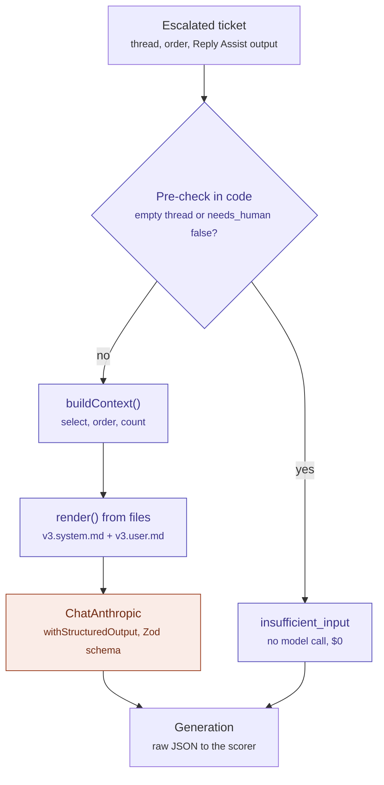
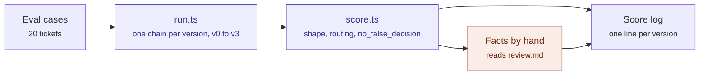

# Handover note

Drafts a short internal note for the colleague who picks up a support ticket that an AI reply assistant escalated.

Built on LangChain (`@langchain/anthropic`, `claude-sonnet-4-5`). All nine steps are done; v3 is below the facts threshold (see the score log).

## Architecture

### One ticket through v3

Every step is plain code except the one model call. Empty or non-escalated
tickets never reach the model.



The pre-check is a LangChain `RunnableBranch` in [`src/run.ts`](src/run.ts). The
context builder is [`src/context.ts`](src/context.ts) and the model setup is
[`src/model.ts`](src/model.ts). `includeRaw: true` keeps a note that fails the Zod
word limit, so it gets scored as a failure instead of throwing.

### The eval loop

Every prompt version runs the same 20 cases. Three criteria are checked in code
and one is scored by a person reading the review page.



## Layout

- `BRIEF.md` – what the project is and the nine steps
- `src/` – model (`model.ts`), context builder (`context.ts`), prompts (`prompt.ts`), runner and scorer
- `prompts/render.ts` – fills `{{slots}}`, throws `missing prompt slot: …`
- `prompts/handover-note/` – task definition, context budget, v3 prompt files
- `evals/` – criteria, cases, fixtures, score log, runs
- `scripts/` – one-off and check scripts

## Setup

```bash
npm install
cp .env.example .env   # then add your ANTHROPIC_API_KEY
```

## Run

```bash
npm run run:eval -- v3          # 20 cases, saves evals/runs/v3.json and a review page
npm run score -- v3             # rescore a saved run
npm run check                   # render + schema checks
npm run tokens                  # per-piece token counts for context.md
```

## Results

| Version | shape | no_false_decision | routing | facts |
|---|---|---|---|---|
| v0 | 0/20 | 20/20 | 0/20 | 3/20 |
| v1 | 20/20 | 20/20 | 20/20 | 16/20 |
| v2 | 20/20 | 20/20 | 20/20 | 18/20 |
| v3 | 20/20 | 20/20 | 20/20 | 16/20 |
| threshold | ≥18 | ≥20 | ≥20 | ≥18 |

## Credits

Built as practice for an AI engineering course. All tickets, customers and orders in `evals/` are fictional.
